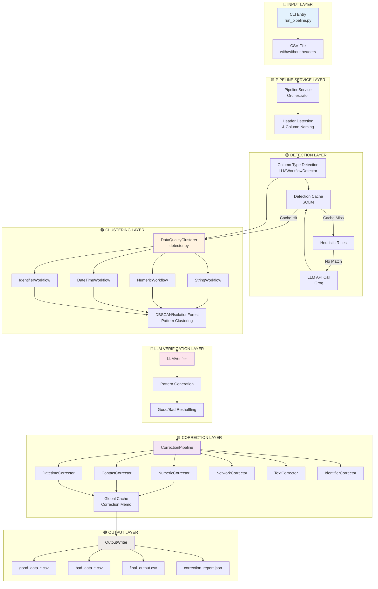
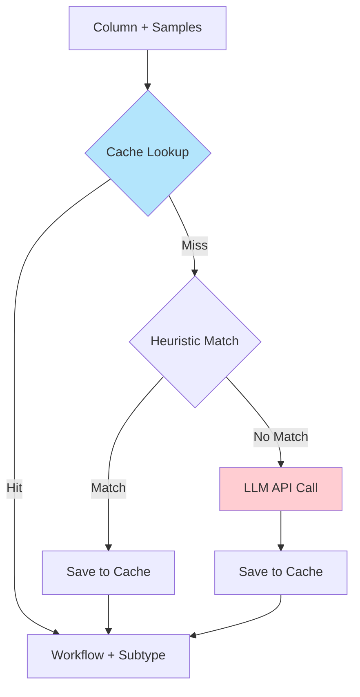
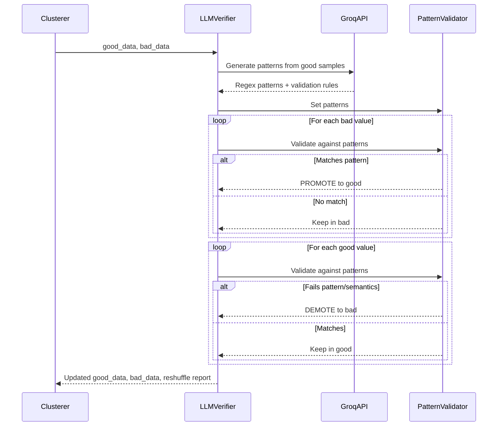
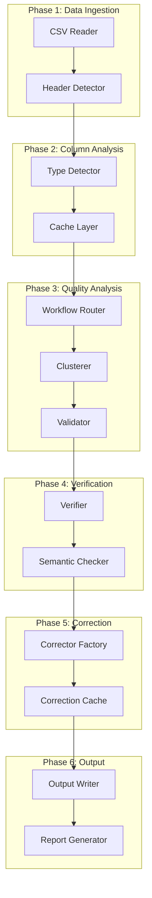

# DATA_CLUSTERING Project - Comprehensive Architecture Documentation

> **Created:** 2026-01-18  
> **Purpose:** Complete architectural documentation for potential rebuild/refactor  
> **Scope:** Entire data quality pipeline from ingestion to output

---

## 📋 Table of Contents

1. [Executive Summary](#executive-summary)
2. [System Overview](#system-overview)
3. [Complete Data Flow](#complete-data-flow)
4. [Component Deep Dive](#component-deep-dive)
5. [Bug Analysis](#bug-analysis)
6. [Recommended Refactoring Strategy](#recommended-refactoring-strategy)

---

## Executive Summary

### Project Purpose
A professional data quality pipeline that automatically detects data anomalies, clusters data by patterns, uses LLM-powered verification, and applies intelligent corrections.

### Current State
- **Total Python Files:** 85+ files
- **Main Directories:** `clustering`, `detection`, `correction`, `llm`, `caching`
- **Supported Workflows:** 4 major workflows (String, Numeric, DateTime, Identifier) with 35+ subworkflows
- **Technology Stack:** Python, Pandas, scikit-learn, DBSCAN clustering, Groq LLM, SQLite caching

### Known Issues (from conversation history)
- ABC promotion bug (uncorrectable values marked as good)
- City heuristics misclassification
- Timestamp validation issues
- Various semantic validation bugs
- LLM reshuffling promoting invalid data

---

## System Overview

### High-Level Architecture



---

## Complete Data Flow

### Stage 1: Data Ingestion & Header Detection

**Entry Point:** `run_pipeline.py`  
**Handler:** `PipelineService.run()`

```python
# Flow
1. CLI arguments parsed (input_file, --no-header, --no-llm)
2. PipelineService initialized
3. CSV loaded with pandas
4. If --no-header:
   - Uses detect_headerless() to analyze first 20 rows
   - Renames columns based on content (col_0 → email, col_1 → phone, etc.)
5. DataFrame ready for processing
```

**Key Files:**
- [run_pipeline.py](file:///c:/Users/pkumar2/OneDrive%20-%20Data%20Axle/Documents/HIGHER_GEAR/DATA_CLUSTERING/run_pipeline.py)
- [pipeline_service.py](file:///c:/Users/pkumar2/OneDrive%20-%20Data%20Axle/Documents/HIGHER_GEAR/DATA_CLUSTERING/backend/services/pipeline_service.py)

---

### Stage 2: Column Type Detection (Workflow Assignment)

**Handler:** `LLMWorkflowDetector`  
**Location:** `backend/core/detection/llm_detector.py`

#### Detection Strategy (3-tier fallback)



**Tier 1: Cache Lookup** (`detection_cache.db`)
- Exact column name match
- Alias resolution (e.g., "ph" → "phone")
- Pattern-based caching for headerless data

**Tier 2: Heuristic Detection**
```python
# backend/core/detection/llm_detector.py: _heuristic_detect()
Rules in SQLite:
- 'email' → contact/email
- 'phone', 'mobile', 'fax' → contact/phone
- 'age' → numeric/age
- 'rating', 'score' → numeric/rating
- 'city', 'town' → text/city
- etc.
```

**Tier 3: LLM Detection**
```python
# Calls Groq LLM with prompt:
"Classify this column: {column_name}"
"Sample data: {samples}"
"Available workflows: {workflow_registry}"

Response: {"workflow": "contact", "subworkflow": "email", "confidence": 0.95}
```

**Key Files:**
- [llm_detector.py](file:///c:/Users/pkumar2/OneDrive%20-%20Data%20Axle/Documents/HIGHER_GEAR/DATA_CLUSTERING/backend/core/detection/llm_detector.py)
- [detection_cache.py](file:///c:/Users/pkumar2/OneDrive%20-%20Data%20Axle/Documents/HIGHER_GEAR/DATA_CLUSTERING/backend/core/detection/detection_cache.py)
- [pattern_detector.py](file:///c:/Users/pkumar2/OneDrive%20-%20Data%20Axle/Documents/HIGHER_GEAR/DATA_CLUSTERING/backend/core/detection/pattern_detector.py)

---

### Stage 3: Clustering & Anomaly Detection

**Handler:** `DataQualityClusterer`  
**Location:** `backend/core/clustering/detector.py` (3,362 lines!)

#### Workflow-Specific Clustering

The system routes to specialized workflows:

```python
routing_map = {
    'text': StringWorkflow,
    'numeric': NumericWorkflow,
    'datetime': DateTimeWorkflow,
    'identifier': IdentifierWorkflow
}
```

#### 🔸 StringWorkflow

**Subworkflows (16 total):**
- `email`, `phone`, `url`, `ip_address`, `uuid`
- `name`, `company`, `address`, `location` (city), `state`, `country`, `zipcode`
- `username`, `file_path`, `product_title`, `generic`

**Validation Engines:**
```python
engines = {
    'email': EmailEngine(),        # Regex + basic validation
    'phone': PhoneEngine(),        # Digit count + format check
    'url': URLEngine(),            # Protocol + domain check
    'name': PersonNameEngine(),    # Word count + alpha ratio
    'company': CompanyEngine(),    # Suffix detection (Inc, LLC)
    'location': LocationEngine(),  # City name lookup
    'zipcode': ZipCodeEngine(),   # 5/9 digit validation
    # ... etc
}
```

**Clustering Method:**
1. Detect string subtype (email, phone, etc.)
2. Apply validation engine to classify good/bad
3. For **identifiers**: Enforce pattern consistency
   - Extract pattern signatures (e.g., "AAA-999-BBB")
   - If 60%+ match one pattern, reject outliers
4. For **generic strings**: Apply semantic validation

**Key Code Section:**
```python
# detector.py: StringWorkflow.cluster()
for item in data:
    if engine.validate(item):
        good_data.append(item)
    else:
        bad_data.append(item)

# Pattern enforcement for IDs
if is_identifier and good_data:
    signatures = [create_pattern_signature(x) for x in good_data]
    most_common_sig = Counter(signatures).most_common(1)[0]
    # Reject outliers
```

#### 🔸 NumericWorkflow

**Subworkflows (14 total):**
- `age`, `year`, `salary`, `amount`, `count`
- `rating`, `percentage`, `temperature`
- `latitude`, `longitude`
- `phone` (numeric only), `zipcode`, `numeric_id`, `generic_numeric`

**Detection Logic:**
```python
# Priority 1: Column name hints
if 'rating' in column_name.lower():
    return 'rating'
if 'age' in column_name.lower():
    return 'age'

# Priority 2: Data pattern analysis
unique_ratio = len(unique_values) / len(values)
if unique_ratio > 0.95 and max_val > 1000:
    return 'id'
if min_val >= 0 and max_val <= 120:
    return 'age'
```

**Clustering Method:**
1. Detect numeric subtype
2. Apply domain validation (semantic constraints)
   - Age: 0-120
   - Rating: 0-10
   - Latitude: -90 to 90
   - Longitude: -180 to 180
3. Use DBSCAN for pattern clustering (phone numbers, IDs)

**Semantic Constraints:**
```python
# pipeline_service.py: _get_semantic_constraints()
constraints = {
    'age': {'min': 0, 'max': 120},
    'rating': {'min': 0, 'max': 10},
    'percentage': {'min': 0, 'max': 100},
    'year': {'min': 1900, 'max': 2100},
    # ...
}
```

#### 🔸 DateTimeWorkflow

**Subworkflows (2 total):**
- `date` (date only)
- `datetime` (date + time)

**Clustering Method:**
1. Parse dates using `dateutil.parser`
2. Cluster by format pattern
   - `YYYY-MM-DD` vs `MM/DD/YYYY` vs `DD-MM-YYYY`
3. **Majority format becomes "good"**
4. Other valid formats go to "bad" for correction

**Format Detection:**
```python
patterns = Counter([extract_date_format(d) for d in dates])
majority_format = patterns.most_common(1)[0][0]

good_data = [d for d in dates if format_matches(d, majority_format)]
bad_data = [d for d in dates if not format_matches(d, majority_format)]
```

#### 🔸 IdentifierWorkflow

**Subworkflows (3 total):**
- `pattern_id` (e.g., "ABC-123", "PROD-001")
- `numeric_id` (e.g., "001", "123456")
- `generic_id`

**Clustering Method:**
1. Extract pattern fingerprints
2. Group by identical patterns
3. Majority pattern = good
4. Outliers = bad

**Key Files:**
- [detector.py](file:///c:/Users/pkumar2/OneDrive%20-%20Data%20Axle/Documents/HIGHER_GEAR/DATA_CLUSTERING/backend/core/clustering/detector.py) (MASSIVE - 3,362 lines)
- [identifier_workflow.py](file:///c:/Users/pkumar2/OneDrive%20-%20Data%20Axle/Documents/HIGHER_GEAR/DATA_CLUSTERING/backend/core/clustering/identifier_workflow.py)
- [column_type_detector.py](file:///c:/Users/pkumar2/OneDrive%20-%20Data%20Axle/Documents/HIGHER_GEAR/DATA_CLUSTERING/backend/core/clustering/column_type_detector.py)

---

### Stage 4: LLM Pattern Generation & Reshuffling

**Handler:** `LLMVerifier`  
**Location:** `backend/core/clustering/detector.py` (Lines 1693-1983)

#### Purpose
Re-verify clustering results using LLM-generated validation patterns.

#### Process Flow



#### Semantic Validation Rules

**CRITICAL:** This is where many bugs occur!

```python
# detector.py: LLMVerifier.verify_and_reshuffle()

# Priority rules (checked BEFORE LLM):
1. Domain-validated types (rating, age, year) → TRUST clustering
2. DateTime types → TRUST clustering
3. All others → LLM pattern validation + semantic checks

# Semantic checks:
run_semantic_checks(value, detected_type, column_name):
    - Date: Check month (1-12), day (1-31)
    - Age: Check range (0-120)
    - Latitude: Check range (-90 to 90)
    - Longitude: Check range (-180 to 180)
    - SSN: Reject known invalid patterns (000-xx-xxxx)
    - IP: Validate octets (0-255)
    - Credit Card: Reject all-same-digit patterns
```

**BUG ALERT:** The reshuffling logic can incorrectly promote bad values!

Example from conversation history:
- 'ABC' (uncorrectable) was promoted from bad → good
- Issue: LLM pattern was too lenient
- Fix needed: Add validation AFTER promotion to verify correctability

**Key Code:**
```python
# Lines 1863-1876: Promotion logic
for item in bad_data:
    if 'identifier' in detected_type:
        # BLOCKED: Trust fingerprint, don't let LLM override
        new_bad.append(item)
        continue
    
    is_valid, confidence = pattern_validator.validate(item)
    if is_valid and confidence > 0.7:
        should_block = run_semantic_checks(item)
        if not should_block:
            promoted.append(item)  # ⚠️ BUG RISK HERE
```

---

### Stage 5: Correction Engines

**Handler:** `CorrectionPipeline`  
**Location:** `backend/core/correction/pipeline.py`

#### Corrector Mapping

```python
CORRECTOR_MAP = {
    'numeric': NumericCorrector,
    'contact': ContactCorrector,
    'datetime': DatetimeCorrector,
    'network': NetworkCorrector,
    'text': TextCorrector,
    'time': TimeCorrector,
    'identifier': IdentifierCorrector,
    'coded_value': CodedValueCorrector,
    # Generics
    'generic_numeric': GenericNumericCorrector,
    'generic_datetime': GenericDatetimeCorrector,
    'generic_identifier': GenericIdentifierCorrector,
}
```

#### 🔧 NumericCorrector

**Location:** `backend/core/correction/numeric_corrector.py`

**Handles:**
- Age outliers (e.g., 999 → reject)
- Salary formatting (remove $, commas)
- Rating normalization (0-5 scale → 0-10 scale)
- Percentage conversion (0.95 → 95%)

**Key Logic:**
```python
def correct(self, value, subtype, semantic_constraints):
    # Step 1: Basic cleaning
    value_clean = str(value).strip().replace(',', '')
    
    # Step 2: Type-specific fixes
    if subtype == 'age':
        if float(value_clean) > 120:
            return REJECT  # Outlier
    
    if subtype == 'rating':
        # Normalize to 0-10 scale
        if max_rating == 5:
            value_clean = float(value_clean) * 2
    
    # Step 3: Semantic constraint validation
    if semantic_constraints:
        if not (min_val <= value_clean <= max_val):
            return REJECT
    
    return value_clean, confidence, changes_made
```

#### 🔧 ContactCorrector

**Location:** `backend/core/correction/contact_corrector.py`

**Handles:**
- Email: Fix typos (gmial.com → gmail.com)
- Phone: Standardize format, add country codes
- URL: Add missing protocols (http://)
- Address: Standardize abbreviations (St. → Street)

**Problem Pattern Detection:**
```python
# backend/core/correction/problem_patterns.py
COMMON_PROBLEMS = {
    'email': {
        'gmial.com': 'gmail.com',
        'yahooo.com': 'yahoo.com',
        '@gmai.com': '@gmail.com'
    },
    'phone': {
        'digit_migration': r'(\\d)(\\d{3})(\\d{3})(\\d{4})',  # 11234567890 → 1-234-567-8901
        'missing_area_code': 'prepend_default'
    }
}
```

**BUG from conversation:** Phone regex used JavaScript syntax `$1` instead of Python `\\g<1>`

#### 🔧 DatetimeCorrector

**Location:** `backend/core/correction/datetime_corrector.py`

**Handles:**
- Format standardization (MM/DD/YYYY → YYYY-MM-DD)
- Digit migration fix (2025-01-01 → 2025-01-01 ✓, but 2023-13-45 → REJECT)
- Preserve majority date format

**Key Logic:**
```python
def correct(self, date_str, target_format):
    # Parse with multiple formats
    parsed_date = dateutil.parser.parse(date_str, fuzzy=True)
    
    # Validate parsed date
    if not (1 <= parsed_date.month <= 12):
        return REJECT  # Invalid month
    if not (1 <= parsed_date.day <= 31):
        return REJECT  # Invalid day
    
    # Reformat to target
    corrected = parsed_date.strftime(target_format)
    return corrected, confidence, changes_made
```

**BUG from conversation:** Invalid dates like `2023-13-45` were not being rejected

#### 🔧 TextCorrector

**Location:** `backend/core/correction/text_corrector.py`

**Handles:**
- Casing fixes (titlecase, uppercase, lowercase)
- Whitespace normalization
- Special character handling
- Department codes (IT, HR should NOT be title-cased)

**Fingerprint Alignment:**
```python
# Uses fingerprint from good data
good_fingerprint = {
    'avg_length': 25,
    'has_numbers': False,
    'case_style': 'titlecase',
    'word_count_avg': 2
}

def correct(self, bad_value, fingerprint):
    # Align to fingerprint
    if fingerprint['case_style'] == 'titlecase':
        corrected = bad_value.title()
    
    # Special handling for dept codes
    if column_name == 'department' and bad_value.upper() in ['IT', 'HR']:
        corrected = bad_value.upper()
    
    return corrected
```

#### 🔧 IdentifierCorrector

**Location:** `backend/core/correction/identifier_corrector.py`

**Handles:**
- Pattern alignment (ABC-123 → ABC-0123)
- Zero-padding (123 → 00123)
- Prefix/suffix standardization

**Pattern Fingerprint:**
```python
fingerprint = {
    'pattern': 'AAA-9999',
    'length': 8,
    'separator': '-',
    'parts': ['alpha:3', 'numeric:4']
}

def correct(self, value, fingerprint):
    # Parse parts
    parts = value.split('-')
    
    # Align each part
    if len(parts[1]) < 4:
        parts[1] = parts[1].zfill(4)  # Zero-pad
    
    return '-'.join(parts)
```

#### Global Correction Cache

**Location:** `backend/core/correction/global_cache.py`

**Purpose:** Memoization - never correct the same value twice

```python
cache = {
    'johndoe@gmial.com': 'johndoe@gmail.com',
    '2025-01-01': '2025-01-01',  # Already correct
    '123': '00123',  # Padded
}

def get_or_correct(value, corrector_func):
    if value in cache:
        return cache[value]
    
    corrected = corrector_func(value)
    cache[value] = corrected
    return corrected
```

**Key Files:**
- [base_corrector.py](file:///c:/Users/pkumar2/OneDrive%20-%20Data%20Axle/Documents/HIGHER_GEAR/DATA_CLUSTERING/backend/core/correction/base_corrector.py)
- [numeric_corrector.py](file:///c:/Users/pkumar2/OneDrive%20-%20Data%20Axle/Documents/HIGHER_GEAR/DATA_CLUSTERING/backend/core/correction/numeric_corrector.py)
- [contact_corrector.py](file:///c:/Users/pkumar2/OneDrive%20-%20Data%20Axle/Documents/HIGHER_GEAR/DATA_CLUSTERING/backend/core/correction/contact_corrector.py)
- [datetime_corrector.py](file:///c:/Users/pkumar2/OneDrive%20-%20Data%20Axle/Documents/HIGHER_GEAR/DATA_CLUSTERING/backend/core/correction/datetime_corrector.py)
- [text_corrector.py](file:///c:/Users/pkumar2/OneDrive%20-%20Data%20Axle/Documents/HIGHER_GEAR/DATA_CLUSTERING/backend/core/correction/text_corrector.py)
- [identifier_corrector.py](file:///c:/Users/pkumar2/OneDrive%20-%20Data%20Axle/Documents/HIGHER_GEAR/DATA_CLUSTERING/backend/core/correction/identifier_corrector.py)

---

### Stage 6: Output Generation

**Handler:** `OutputWriter`  
**Location:** `backend/core/correction/output_writer.py`

#### Generated Files

```
backend/output/
├── good_n_bad/
│   ├── good_data_email.csv
│   ├── bad_data_email.csv
│   ├── good_data_age.csv
│   ├── bad_data_age.csv
│   └── ... (one pair per subtype)
│
├── final/
│   └── final_output.csv          # Merged good + corrected data
│
└── report/
    └── correction_report_*.csv   # Detailed correction log
```

#### Report Format

```csv
column_name,workflow,subtype,original_value,corrected_value,confidence,status
email,contact,email,johndoe@gmial.com,johndoe@gmail.com,0.95,corrected
age,numeric,age,999,,0,rejected
phone,contact,phone,1234567890,+1-234-567-8901,0.85,corrected
```

**Row Alignment:**
Critical feature - ensures row 5 stays row 5 across all outputs

```python
# pipeline_service.py
base_rows = {
    0: {'email': 'john@example.com', 'age': '25', ...},
    1: {'email': 'jane@example.com', 'age': '30', ...},
    # ...
}

# Correction preserves row indices
corrected_with_indices = [
    (0, 'john@example.com', 'john@example.com'),
    (1, 'jane@gmial.com', 'jane@gmail.com'),
]

# Final output merges by index
final_df = merge_by_row_index(base_rows, corrected_data)
```

---

## Component Deep Dive

### 📁 Directory Structure

```
DATA_CLUSTERING/
├── run_pipeline.py                    # CLI entry point
├── backend/
│   ├── services/
│   │   └── pipeline_service.py        # Main orchestrator
│   │
│   ├── core/
│   │   ├── clustering/                # Anomaly detection
│   │   │   ├── detector.py            # 3,362 lines (⚠️ MASSIVE)
│   │   │   ├── column_type_detector.py
│   │   │   ├── identifier_workflow.py
│   │   │   ├── location_engine.py
│   │   │   └── person_engine.py
│   │   │
│   │   ├── detection/                 # Workflow detection
│   │   │   ├── llm_detector.py
│   │   │   ├── detection_cache.py
│   │   │   ├── pattern_detector.py
│   │   │   └── semantic_validator.py
│   │   │
│   │   ├── correction/                # Correction engines
│   │   │   ├── pipeline.py
│   │   │   ├── base_corrector.py
│   │   │   ├── numeric_corrector.py
│   │   │   ├── contact_corrector.py
│   │   │   ├── datetime_corrector.py
│   │   │   ├── text_corrector.py
│   │   │   ├── identifier_corrector.py
│   │   │   ├── network_corrector.py
│   │   │   ├── global_cache.py
│   │   │   └── output_writer.py
│   │   │
│   │   ├── llm/                       # LLM integration
│   │   │   └── service.py             # Groq API wrapper
│   │   │
│   │   ├── caching/                   # Fingerprint caching
│   │   │   └── fingerprint.py
│   │   │
│   │   └── verification/              # Validation layer
│   │
│   └── config/                        # Workflow configs
│       └── workflows/
│
├── data/                              # Input CSV files
├── PROJECT_ARCHIETECTURE/              # Existing docs
└── venv/                              # Python environment
```

### 🔑 Key Components

#### 1. DataQualityClusterer (detector.py)

**Size:** 3,362 lines (NEEDS REFACTORING!)

**Responsibilities:**
- Column type auto-detection
- Workflow routing
- Clustering/anomaly detection
- LLM verification
- Correction orchestration (legacy)

**Classes Defined:**
- `ValidationEngine` - Base validation
- 20+ specific engines (`EmailEngine`, `PhoneEngine`, etc.)
- `StringWorkflow` - String clustering
- `NumericWorkflow` - Numeric clustering
- `DateTimeWorkflow` - Date/time clustering
- `IdentifierWorkflow` - ID clustering
- `LLMVerifier` - Pattern generation & reshuffling
- `DataQualityClusterer` - Main coordinator

**⚠️ PROBLEM:** This file is doing too much! Should be split into:
- `workflows/string_workflow.py`
- `workflows/numeric_workflow.py`
- `workflows/datetime_workflow.py`
- `workflows/identifier_workflow.py`
- `engines/validation_engines.py`
- `verification/llm_verifier.py`

#### 2. LLMWorkflowDetector (llm_detector.py)

**Size:** 223 lines

**Responsibilities:**
- Column → Workflow mapping
- 3-tier detection (cache → heuristics → LLM)
- Caching results to SQLite

**Database Schema:**
```sql
-- detection_cache.db
CREATE TABLE workflow_cache (
    column_name TEXT PRIMARY KEY,
    workflow TEXT,
    subworkflow TEXT,
    confidence REAL,
    source TEXT  -- 'cache', 'heuristic', 'llm'
);

CREATE TABLE column_aliases (
    alias TEXT PRIMARY KEY,
    canonical_column TEXT
);

CREATE TABLE heuristic_rules (
    pattern TEXT,
    workflow TEXT,
    subworkflow TEXT,
    priority INTEGER
);

CREATE TABLE pattern_cache (
    pattern_hash TEXT PRIMARY KEY,
    workflow TEXT,
    subworkflow TEXT,
    sample_values TEXT
);
```

#### 3. CorrectionPipeline (pipeline.py)

**Size:** 399 lines

**Responsibilities:**
- Route to correct corrector
- Maintain correction batches
- Write outputs
- Generate correction reports

**Batch Structure:**
```python
batch = {
    'column_name': 'email',
    'workflow': 'contact',
    'subtype': 'email',
    'corrections': [
        {
            'original': 'johndoe@gmial.com',
            'corrected': 'johndoe@gmail.com',
            'confidence': 0.95,
            'changes_made': ['domain_typo_fix']
        }
    ],
    'rejections': ['invalid@', 'notanemail']
}
```

#### 4. GroqLLMService (llm/service.py)

**Responsibilities:**
- API calls to Groq LLM
- Retry logic (max 3 attempts)
- Pattern generation
- Data quality assessment

**API Methods:**
```python
class GroqLLMService:
    def generate_validation_patterns(self, samples):
        """Generate regex patterns from good data samples"""
    
    def assess_data_quality(self, column, data_type, good_samples, bad_items):
        """Get LLM opinion on borderline cases"""
    
    def generate_semantic_constraints(self, column_name, samples):
        """Generate domain validation rules"""
```

---

## Bug Analysis

Based on conversation history, here are the major bug categories:

### 🐛 Category 1: LLM Reshuffling Errors

**Problem:** LLM promotes uncorrectable values from bad → good

**Example:** `ABC` promoted to good, appears in final output as-is

**Root Cause:**
```python
# detector.py: Lines 1863-1876
for item in bad_data:
    is_valid, confidence = pattern_validator.validate(item)
    if is_valid and confidence > 0.7:
        promoted.append(item)  # ⚠️ NO CORRECTABILITY CHECK!
```

**Fix Needed:**
```python
for item in bad_data:
    is_valid, confidence = pattern_validator.validate(item)
    if is_valid and confidence > 0.7:
        # NEW: Verify it can be corrected OR is already valid
        corrected, corr_confidence = corrector.correct(item)
        if corr_confidence > 0.8:
            promoted.append(item)
        else:
            new_bad.append(item)  # Keep in bad if uncorrectable
```

---

### 🐛 Category 2: Semantic Validation Gaps

**Problem:** Invalid values passing validation

**Examples:**
- Dates: `2023-13-45` (month 13, day 45)
- Ages: `999`, `150`
- Ratings: Out of expected range

**Root Cause:** Semantic checks happen AFTER clustering, but LLM can override

**Current Flow:**
```
Clustering → LLM reshuffles → Semantic checks (too late!)
```

**Better Flow:**
```
Clustering → Semantic checks → LLM reshuffles (with semantic blocking)
```

**Fix Location:** `detector.py` Lines 1772-1827

---

### 🐛 Category 3: Heuristic Priority Issues

**Problem:** City columns classified as address instead of text/city

**Root Cause:**
```python
# llm_detector.py: _heuristic_detect()
Heuristic rules priority:
1. 'address' (too broad)
2. 'city' (too specific)

Column 'address_city' matches 'address' first!
```

**Fix Needed:** Prioritize more specific patterns
```python
# NEW priority order
if 'city' in column_name or 'town' in column_name:
    return 'text/city'  # Check BEFORE address
if 'address' in column_name:
    return 'contact/address'
```

---

### 🐛 Category 4: Timestamp Validation

**Problem:** Valid timestamps ending up in bad_data

**Root Cause:** Majorityformat logic is too strict

**Example:**
```
Good: YYYY-MM-DD HH:MM:SS (80%)
Bad: YYYY-MM-DDTHH:MM:SS (20% - ISO format!)

Issue: ISO format is VALID but non-majority
```

**Fix Needed:** Allow all valid formats in good_data
```python
# Instead of
good_data = [d for d in dates if format == majority_format]

# Use
good_data = [d for d in dates if is_valid_date(d)]
bad_data = [d for d in dates if not is_valid_date(d)]

# THEN in correction:
if date_format != majority_format:
    corrected = reformat(date, majority_format)
```

---

### 🐛 Category 5: Regex Backreference Syntax

**Problem:** LLM generates JavaScript regex syntax for Python

**Example:**
```python
# Generated by LLM
pattern = r'(\d)(\d{3})(\d{3})(\d{4})'
replacement = '$1-$2-$3-$4'  # ❌ JavaScript syntax

# Should be
replacement = r'\g<1>-\g<2>-\g<3>-\g<4>'  # ✅ Python syntax
```

**Fix:** Post-process LLM regex patterns
```python
def fix_backreferences(pattern_string):
    # Convert $1 → \g<1>
    return re.sub(r'\$(\d+)', r'\\g<\1>', pattern_string)
```

---

### 🐛 Category 6: Department Casing

**Problem:** "IT" becomes "It", "HR" becomes "Hr"

**Root Cause:** Generic title-casing applied to all text

**Fix:**
```python
# text_corrector.py
PRESERVE_UPPERCASE = ['IT', 'HR', 'PR', 'QA', 'CEO', 'CFO', 'CTO']

def correct(self, value, column_name):
    if column_name.lower() == 'department':
        if value.upper() in PRESERVE_UPPERCASE:
            return value.upper()
    
    return value.title()  # Default
```

---

## Recommended Refactoring Strategy

### 🎯 Option 1: Incremental Refactor (Safer)

**Timeline:** 2-3 weeks  
**Risk:** Low  
**Benefit:** Gradual improvement with continuous testing

**Steps:**

1. **Week 1: Split detector.py**
   - Extract workflows into separate files
   - Extract validation engines
   - Extract LLM verifier
   - Keep APIs identical (no behavior change)

2. **Week 2: Fix critical bugs**
   - Add correctability check to LLM promotion
   - Fix semantic validation ordering
   - Improve heuristic priorities
   - Add regex syntax post-processing

3. **Week 3: Add comprehensive tests**
   - Unit tests for each workflow
   - Integration tests for full pipeline
   - Regression tests for known bugs

**File Structure After Refactor:**
```
backend/core/
├── workflows/
│   ├── base_workflow.py
│   ├── string_workflow.py
│   ├── numeric_workflow.py
│   ├── datetime_workflow.py
│   └── identifier_workflow.py
│
├── engines/
│   ├── base_engine.py
│   ├── email_engine.py
│   ├── phone_engine.py
│   ├── name_engine.py
│   └── ... (20+ engines)
│
├── verification/
│   ├── llm_verifier.py
│   ├── pattern_validator.py
│   └── semantic_validator.py
│
└── clustering/
    └── clusterer.py (much smaller!)
```

---

### 🚀 Option 2: Complete Rebuild (Riskier but Cleaner)

**Timeline:** 4-6 weeks  
**Risk:** High  
**Benefit:** Clean architecture, easier to maintain

**Architecture:**



**New Design Principles:**

1. **Single Responsibility:** Each module does ONE thing
2. **Dependency Injection:** Testable components
3. **Plugin Architecture:** Easy to add new workflows/engines
4. **Immutable Data:** Prevent state bugs
5. **Comprehensive Logging:** Track every decision

**Sample Code Structure:**
```python
# workflows/base_workflow.py
class BaseWorkflow(ABC):
    @abstractmethod
    def detect_subtype(self, data, column_name):
        pass
    
    @abstractmethod
    def cluster(self, data):
        pass
    
    @abstractmethod
    def get_corrector(self, subtype):
        pass

# workflows/string_workflow.py
class StringWorkflow(BaseWorkflow):
    def __init__(self, engines: Dict[str, ValidationEngine]):
        self.engines = engines
    
    def detect_subtype(self, data, column_name):
        # Clean, focused logic
        pass

# main orchestrator
class Pipeline:
    def __init__(
        self,
        detector: TypeDetector,
        workflows: Dict[str, BaseWorkflow],
        verifier: Verifier,
        corrector_factory: CorrectorFactory,
        writer: OutputWriter
    ):
        # All dependencies injected
        self.detector = detector
        self.workflows = workflows
        # ...
    
    def run(self, csv_path):
        # Clear, linear flow
        df = self.load_csv(csv_path)
        for column in df.columns:
            workflow_type = self.detector.detect(column)
            workflow = self.workflows[workflow_type]
            clustered = workflow.cluster(df[column])
            verified = self.verifier.verify(clustered)
            corrected = self.corrector_factory.correct(verified)
            self.writer.write(corrected)
```

---

### 📊 Comparison

| Aspect | Incremental Refactor | Complete Rebuild |
|--------|---------------------|------------------|
| **Timeline** | 2-3 weeks | 4-6 weeks |
| **Risk** | Low | High |
| **Code Reuse** | ~70% | ~30% |
| **Bug Fix** | Gradual | All at once |
| **Testing** | Continuous | Final phase |
| **Downtime** | None | Potentially some |
| **Learning Curve** | Low | Medium |
| **Long-term Maintainability** | Good | Excellent |

---

## 📝 Immediate Action Plan

### If Choosing Incremental Refactor:

1. **TODAY: Create task breakdown**
   - List all files to split
   - Identify critical bug fixes
   - Set up test framework

2. **Day 1-3: Split detector.py**
   ```bash
   git checkout -b refactor/split-detector
   # Create new files
   # Move code
   # Update imports
   # Run tests
   git commit -m "Split detector.py into workflow modules"
   ```

3. **Day 4-7: Fix critical bugs**
   - LLM promotion correctability check
   - Semantic validation ordering
   - Heuristic priorities

4. **Day 8-14: Add tests & validate**
   - Write unit tests
   - Run full pipeline tests
   - Compare outputs with baseline

5. **Day 15-21: Documentation & cleanup**
   - Update architecture docs
   - Add inline comments
   - Code review & merge

### If Choosing Complete Rebuild:

1. **Week 1: Design & Planning**
   - Finalize architecture
   - Define all interfaces
   - Set up project structure
   - Create test datasets

2. **Week 2-3: Core Implementation**
   - Implement base classes
   - Build workflows
   - Build correctors
   - Unit tests for each

3. **Week 4: Integration**
   - Wire everything together
   - Integration tests
   - Performance testing

4. **Week 5: Migration**
   - Run side-by-side with old system
   - Compare outputs
   - Fix discrepancies

6. **Week 6: Cutover**
   - Full system test
   - Documentation
   - Deploy

---

## 🏁 Conclusion

Your project has a solid foundation but has accumulated technical debt through iterative bug fixes. The core logic is sound:

**Strengths:**
- ✅ Smart 3-tier detection (cache → heuristics → LLM)
- ✅ Comprehensive workflow coverage (35+ subtypes)
- ✅ LLM integration for flexibility
- ✅ Caching for performance

**Weaknesses:**
- ❌ Monolithic `detector.py` (3,362 lines)
- ❌ LLM reshuffling bugs (promotes uncorrectable values)
- ❌ Semantic validation timing issues
- ❌ Heuristic priority conflicts

**Recommendation:** 
Start with **Incremental Refactor** to fix bugs quickly, then plan a **Complete Rebuild** for v2.0 if needed.

---

**Next Steps:**
1. Review this documentation
2. Decide on refactoring strategy
3. Create detailed task breakdown
4. Begin implementation

Would you like me to create the detailed task breakdown for either strategy?
