# Detailed Data Flow Diagram

> **Purpose:** Track data transformations through every stage  
> **Use:** Understand where bugs can be introduced  

---

## Complete Data Journey

```mermaid
flowchart TD
    Start([User runs:<br/>python run_pipeline.py data.csv]) --> ReadCSV
    
    subgraph Entry["🔵 ENTRY - run_pipeline.py"]
        ReadCSV[Parse CLI Args<br/>--no-header<br/>--no-llm]
        ReadCSV --> InitService[Initialize PipelineService]
    end
    
    subgraph Ingestion["🟢 INGESTION - pipeline_service.py:run()"]
        InitService --> LoadDF[pd.read_csv<br/>Load DataFrame]
        LoadDF --> CheckHeader{Has Header?}
        
        CheckHeader -->|Yes| UseHeader[Use existing<br/>column names]
        CheckHeader -->|No| DetectCols[llm_detector.py:<br/>detect_headerless]
        
        DetectCols --> RenameCols[Rename col_0→email<br/>col_1→phone<br/>etc.]
        RenameCols --> UseHeader
        
        UseHeader --> IterCols[For each column]
    end
    
    subgraph Detection["🟡 DETECTION - llm_detector.py:detect()"]
        IterCols --> CacheLookup{Cache Hit?<br/>detection_cache.db}
        
        CacheLookup -->|Hit| CacheResult[Return cached<br/>workflow/subtype]
        CacheLookup -->|Miss| Heuristics[Check heuristic_rules<br/>table]
        
        Heuristics --> HeurMatch{Pattern Match?}
        HeurMatch -->|Yes| SaveH[Save to cache<br/>source='heuristic']
        HeurMatch -->|No| CallLLM[Groq API Call<br/>llm/service.py]
        
        CallLLM --> Wait[Wait for response<br/>max 3 retries]
        Wait --> SaveL[Save to cache<br/>source='llm']
        
        SaveH --> WorkflowAssigned
        SaveL --> WorkflowAssigned
        CacheResult --> WorkflowAssigned[Workflow + Subtype<br/>Assigned]
    end
    
    subgraph Clustering["🟠 CLUSTERING - detector.py:cluster_column()"]
        WorkflowAssigned --> RouteWF{Route by<br/>Workflow}
        
        RouteWF -->|text| StringWF[StringWorkflow.cluster]
        RouteWF -->|numeric| NumericWF[NumericWorkflow.cluster]
        RouteWF -->|datetime| DateTimeWF[DateTimeWorkflow.cluster]
        RouteWF -->|identifier| IdentifierWF[IdentifierWorkflow.cluster]
        
        StringWF --> DetectStrType[detect_string_type<br/>email/phone/url/etc]
        NumericWF --> DetectNumType[detect_numeric_type<br/>age/rating/id/etc]
        DateTimeWF --> DetectDTType[Parse dates<br/>dateutil.parser]
        IdentifierWF --> ExtractPattern[Create pattern<br/>signatures]
        
        DetectStrType --> ValidateStr[Validation Engine<br/>EmailEngine/PhoneEngine/etc]
        DetectNumType --> ValidateNum[Semantic Constraints<br/>age:0-120, rating:0-10]
        DetectDTType --> ValidateDT[Format Clustering<br/>YYYY-MM-DD vs MM/DD/YYYY]
        ExtractPattern --> ValidateID[Pattern Consistency<br/>AAA-999 vs AA-9999]
        
        ValidateStr --> SplitGoodBad1[Split:<br/>good_data<br/>bad_data]
        ValidateNum --> SplitGoodBad1
        ValidateDT --> SplitGoodBad1
        ValidateID --> SplitGoodBad1
    end
    
    subgraph LLMVerify["🔴 LLM VERIFY - detector.py:LLMVerifier"]
        SplitGoodBad1 --> LLMEnabled{LLM Enabled?<br/>--no-llm flag}
        
        LLMEnabled -->|No| SkipLLM[Skip verification]
        LLMEnabled -->|Yes| GenPatterns[Generate patterns<br/>from good_data samples]
        
        GenPatterns --> GroqCall[Groq API:<br/>generate_validation_patterns]
        GroqCall --> SetPatterns[Set patterns in<br/>PatternValidator]
        
        SetPatterns --> VerifyGood[Verify each good value]
        VerifyGood --> DemoteCheck{Fails pattern or<br/>semantic check?}
        
        DemoteCheck -->|Yes| Demote[DEMOTE<br/>good → bad]
        DemoteCheck -->|No| KeepGood[Keep in good]
        
        SetPatterns --> VerifyBad[Verify each bad value]
        VerifyBad --> PromoteCheck{Matches pattern<br/>confidence>0.7?}
        
        PromoteCheck -->|Yes| SemanticBlock{Semantic Issues?<br/>date:13/45<br/>age:999}
        PromoteCheck -->|No| KeepBad[Keep in bad]
        
        SemanticBlock -->|Yes| KeepBad
        SemanticBlock -->|No| IDBlock{Identifier Type?}
        
        IDBlock -->|Yes| BlockPromotion[⛔ BLOCK<br/>Trust fingerprint]
        IDBlock -->|No| Promote[✅ PROMOTE<br/>bad → good]
        
        Demote --> Reshuffled
        KeepGood --> Reshuffled
        KeepBad --> Reshuffled
        Promote --> Reshuffled
        BlockPromotion --> Reshuffled
        SkipLLM --> Reshuffled
        
        Reshuffled[Reshuffled:<br/>final_good<br/>final_bad]
    end
    
    subgraph Correction["🟣 CORRECTION - correction/pipeline.py"]
        Reshuffled --> GetCorrector[Get corrector by<br/>workflow + subtype]
        
        GetCorrector --> CorrRoute{Route to<br/>Corrector}
        
        CorrRoute -->|numeric| NumCorr[NumericCorrector<br/>numeric_corrector.py]
        CorrRoute -->|contact| ContCorr[ContactCorrector<br/>contact_corrector.py]
        CorrRoute -->|datetime| DTCorr[DatetimeCorrector<br/>datetime_corrector.py]
        CorrRoute -->|text| TxtCorr[TextCorrector<br/>text_corrector.py]
        CorrRoute -->|identifier| IDCorr[IdentifierCorrector<br/>identifier_corrector.py]
        CorrRoute -->|network| NetCorr[NetworkCorrector<br/>network_corrector.py]
        
        NumCorr --> GlobalCache{Global Cache?<br/>global_cache.py}
        ContCorr --> GlobalCache
        DTCorr --> GlobalCache
        TxtCorr --> GlobalCache
        IDCorr --> GlobalCache
        NetCorr --> GlobalCache
        
        GlobalCache -->|Hit| ReturnCached[Return cached<br/>correction]
        GlobalCache -->|Miss| ApplyLogic[Apply correction logic]
        
        ApplyLogic --> BasicClean[1. Basic Clean<br/>trim, unquote]
        BasicClean --> SpecificFix[2. Type-Specific Fix]
        
        SpecificFix --> EmailFix[Email: typo fix<br/>gmial→gmail]
        SpecificFix --> PhoneFix[Phone: format<br/>1234567890→+1-234-567-8901]
        SpecificFix --> DateFix[Date: reformat<br/>MM/DD/YYYY→YYYY-MM-DD]
        SpecificFix --> NumFix[Numeric: validate<br/>age>120→REJECT]
        SpecificFix --> TextFix[Text: fingerprint align<br/>titlecase/uppercase]
        SpecificFix --> IDFix[ID: zero-pad<br/>123→00123]
        
        EmailFix --> SaveCache[Save to global_cache]
        PhoneFix --> SaveCache
        DateFix --> SaveCache
        NumFix --> SaveCache
        TextFix --> SaveCache
        IDFix --> SaveCache
        
        SaveCache --> ReturnCached
        ReturnCached --> CorrResult[Corrected Value<br/>+ Confidence<br/>+ Changes Made]
    end
    
    subgraph Output["🟤 OUTPUT - correction/output_writer.py"]
        CorrResult --> BatchAdd[Add to<br/>CorrectionBatch]
        
        BatchAdd --> AllColsDone{All Columns<br/>Processed?}
        
        AllColsDone -->|No| IterCols
        AllColsDone -->|Yes| WriteOutputs[Write Outputs]
        
        WriteOutputs --> GoodCSV[backend/output/<br/>good_n_bad/<br/>good_data_*.csv]
        WriteOutputs --> BadCSV[backend/output/<br/>good_n_bad/<br/>bad_data_*.csv]
        WriteOutputs --> FinalCSV[backend/output/<br/>final/<br/>final_output.csv]
        WriteOutputs --> ReportJSON[backend/output/<br/>report/<br/>correction_report_*.csv]
        
        GoodCSV --> Done([✅ Pipeline Complete])
        BadCSV --> Done
        FinalCSV --> Done
        ReportJSON --> Done
    end
    
    style Start fill:#e1f5fe
    style Done fill:#c8e6c9
    style Promote fill:#ffcdd2
    style BlockPromotion fill:#ffab91
    style Demote fill:#fff9c4
```



---

## Key Decision Points & Bug Risks

### ⚠️ Critical Decision Point 1: LLM Promotion (Line ~1870)

**Location:** `detector.py:LLMVerifier.verify_and_reshuffle()`

**Current Logic:**
```python
for item in bad_data:
    is_valid, confidence = pattern_validator.validate(item)
    if is_valid and confidence > 0.7:
        should_block = run_semantic_checks(item)
        if not should_block:
            promoted.append(item)  # ⚠️ BUG RISK!
```

**Risk:** Promotes values that match LLM pattern but are **uncorrectable**

**Example:**
- Item: `"ABC"`
- LLM pattern: "Any 3 uppercase letters" ✅ Matches
- Semantic check: None for generic text ✅ Passes
- Result: Promoted to good
- **Problem:** `"ABC"` cannot be corrected to anything meaningful!

**Fix:**
```python
for item in bad_data:
    is_valid, confidence = pattern_validator.validate(item)
    if is_valid and confidence > 0.7:
        should_block = run_semantic_checks(item)
        if not should_block:
            # NEW: Test if correctable
            can_correct = corrector.can_correct(item, column_context)
            if can_correct:
                promoted.append(item)
            else:
                new_bad.append(item)  # Keep in bad
```

---

### ⚠️ Critical Decision Point 2: Semantic Validation Order

**Current Flow:**
```
Clustering → LLM Verification → Semantic Checks
```

**Problem:** LLM can override semantic checks

**Example:**
- Value: `2023-13-45`
- Clusters as: Date
- LLM says: Valid date pattern ✅
- Semantic check (in LLM verify): Month 13 ❌
- **BUT** if semantic check comes too late, value might already be promoted!

**Better Flow:**
```
Clustering → Semantic Checks → LLM Verification (respects semantic results)
```

---

### ⚠️ Critical Decision Point 3: Heuristic Priority

**Location:** `llm_detector.py:_heuristic_detect()`

**Current SQL:**
```sql
SELECT workflow, subworkflow 
FROM heuristic_rules 
WHERE column_name LIKE '%pattern%'
ORDER BY priority ASC  -- Lower number = higher priority
LIMIT 1
```

**Problem:** Generic patterns match before specific ones

**Example:**
- Column: `address_city`
- Matches: `%address%` (priority 10) → `contact/address`
- Should match: `%city%` (priority 50) → `text/city`

**Fix:** Reorder priorities
```sql
-- Current
priority 10: %address%
priority 50: %city%

-- Should be
priority 10: %city%        -- Most specific first
priority 20: %state%
priority 30: %zip%
priority 40: %address%     -- Generic last
```

---

### ⚠️ Critical Decision Point 4: Timestamp Format Strictness

**Location:** `detector.py:DateTimeWorkflow.cluster()`

**Current Logic:**
```python
formats = Counter([extract_format(d) for d in dates])
majority_format = formats.most_common(1)[0][0]

good = [d for d in dates if extract_format(d) == majority_format]
bad = [d for d in dates if extract_format(d) != majority_format]
```

**Problem:** Valid ISO timestamps classified as "bad"

**Example:**
- 80% of dates: `2025-01-18 10:30:00`
- 20% of dates: `2025-01-18T10:30:00Z` (ISO 8601 - VALID!)
- Result: ISO dates go to bad_data ❌

**Fix:** Allow all valid formats in good
```python
good = [d for d in dates if is_valid_datetime(d)]
bad = [d for d in dates if not is_valid_datetime(d)]

# In correction phase
for d in good:
    if extract_format(d) != majority_format:
        corrected = reformat(d, majority_format)
```

---

## Data State Transitions

### State 1: Raw CSV

```csv
email,age,signup_date
johndoe@gmial.com,25,2025-01-01
jane@example.com,999,2025/01/02
invalid@,30,2023-13-45
```

### State 2: After Detection

```python
{
    'email': {'workflow': 'contact', 'subtype': 'email'},
    'age': {'workflow': 'numeric', 'subtype': 'age'},
    'signup_date': {'workflow': 'datetime', 'subtype': 'date'}
}
```

### State 3: After Clustering

```python
{
    'email': {
        'good': ['jane@example.com'],
        'bad': ['johndoe@gmial.com', 'invalid@']
    },
    'age': {
        'good': [25, 30],
        'bad': [999]
    },
    'signup_date': {
        'good': ['2025-01-01'],
        'bad': ['2025/01/02', '2023-13-45']
    }
}
```

### State 4: After LLM Verification

```python
{
    'email': {
        'good': ['jane@example.com'],
        'bad': ['johndoe@gmial.com', 'invalid@'],
        'reshuffled': {
            'promoted': [],
            'demoted': []
        }
    },
    'age': {
        'good': [25, 30],
        'bad': [999],
        'reshuffled': {
            'promoted': [],
            'demoted': []  # 999 stays in bad (semantic check)
        }
    },
    'signup_date': {
        'good': ['2025-01-01', '2025/01/02'],  # ⚠️ Promoted (valid format)
        'bad': ['2023-13-45'],  # Rejected (invalid date)
        'reshuffled': {
            'promoted': ['2025/01/02'],
            'demoted': []
        }
    }
}
```

### State 5: After Correction

```python
corrections = [
    {
        'column': 'email',
        'original': 'johndoe@gmial.com',
        'corrected': 'johndoe@gmail.com',
        'confidence': 0.95,
        'status': 'corrected'
    },
    {
        'column': 'email',
        'original': 'invalid@',
        'corrected': None,
        'confidence': 0,
        'status': 'rejected'
    },
    {
        'column': 'age',
        'original': 999,
        'corrected': None,
        'confidence': 0,
        'status': 'rejected'
    },
    {
        'column': 'signup_date',
        'original': '2025/01/02',
        'corrected': '2025-01-02',
        'confidence': 1.0,
        'status': 'corrected'
    }
]
```

### State 6: Final Output

```csv
email,age,signup_date
johndoe@gmail.com,25,2025-01-01
jane@example.com,30,2025-01-02
[REJECTED],[REJECTED],[REJECTED]
```

---

## File-by-File Data Transformations

| Stage | Input | File | Function | Output |
|-------|-------|------|----------|--------|
| **1. CLI** | Command line | `run_pipeline.py` | `main()` | Args object |
| **2. Init** | Args | `pipeline_service.py` | `__init__()` | PipelineService |
| **3. Load** | CSV path | `pipeline_service.py` | `run()` | DataFrame |
| **4. Header** | DataFrame | `llm_detector.py` | `detect_headerless()` | Renamed cols |
| **5. Detect** | Column name | `llm_detector.py` | `detect()` | workflow/subtype |
| **6. Cache** | Column name | `detection_cache.py` | `get_workflow()` | Cached result or None |
| **7. Heuristic** | Column name | `llm_detector.py` | `_heuristic_detect()` | workflow/subtype or None |
| **8. LLM Call** | Column + samples | `llm/service.py` | `classify_column()` | workflow/subtype |
| **9. Route** | workflow | `detector.py` | `cluster_column()` | Workflow instance |
| **10. Cluster** | Column data | Workflow: `cluster()` | Various validation | good_data, bad_data |
| **11. Verify** | good, bad lists | `detector.py` | `LLMVerifier.verify_and_reshuffle()` | Reshuffled lists |
| **12. Correct** | bad_data | Corrector: `correct()` | Type-specific logic | Corrected values |
| **13. Cache** | Value | `global_cache.py` | `get_or_set()` | Cached or new correction |
| **14. Batch** | Corrections | `pipeline.py` | `CorrectionPipeline.correct_column()` | CorrectionBatch |
| **15. Write** | All batches | `output_writer.py` | `write_outputs()` | CSV files |
| **16. Report** | Batches | `output_writer.py` | `generate_report()` | JSON/CSV report |

---

## Caching Layers

The system has **3 distinct caching layers**:

### Layer 1: Detection Cache (`detection_cache.db`)

**Purpose:** Avoid re-detecting column types

**Scope:** Column name → Workflow mapping

**Lifetime:** Persistent across runs

**Invalidation:** Manual (delete DB file)

**Example:**
```python
# First run
detect('email') → LLM call → 'contact/email' → Save to DB

# Second run
detect('email') → DB lookup → 'contact/email' (instant!)
```

### Layer 2: Pattern Cache (in memory)

**Purpose:** Avoid re-generating LLM patterns

**Scope:** Column name + type → Validation patterns

**Lifetime:** Single pipeline run

**Invalidation:** Process restart

**Example:**
```python
# First column 'email_1'
generate_patterns('email_1', samples) → LLM call → patterns

# Second column 'email_2'  
generate_patterns('email_2', samples) → Cache hit! (same type)
```

### Layer 3: Correction Cache (`global_cache.py`)

**Purpose:** Avoid re-correcting same value

**Scope:** Value → Corrected value

**Lifetime:** Single pipeline run

**Invalidation:** Process restart

**Example:**
```python
# First occurrence
correct('johndoe@gmial.com') → Apply logic → 'johndoe@gmail.com'

# Second occurrence (different column/row)
correct('johndoe@gmial.com') → Cache hit! (instant)
```

---

## Performance Characteristics

### Time Complexity per Column

```
Best case (cached): O(n)
- n = number of rows
- Just lookup, no processing

Average case: O(n log n)
- n = rows
- DBSCAN clustering: O(n log n)

Worst case (LLM): O(n log n) + LLM latency
- n = rows
- Plus 500ms-2s LLM API call
```

### Space Complexity

```
Per column: O(n)
- Store good_data, bad_data arrays
- Pattern cache: O(k) where k = unique pattern count

Total: O(m * n)
- m = number of columns
- n = rows per column
```

### Bottlenecks

1. **LLM API Calls** (500ms-2s each)
   - Mitigated by 3-tier caching
   - Worst case: 1 call per unique column type

2. **DBSCAN Clustering** (O(n log n))
   - Only for large columns (>10k rows)

3. **File I/O** (Write outputs)
   - Mitigated by batch writes

---

This completes the detailed flow diagram. Every decision point, file transition, and potential bug location is documented.
