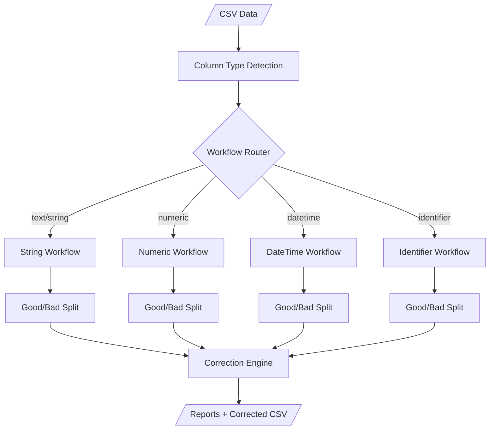
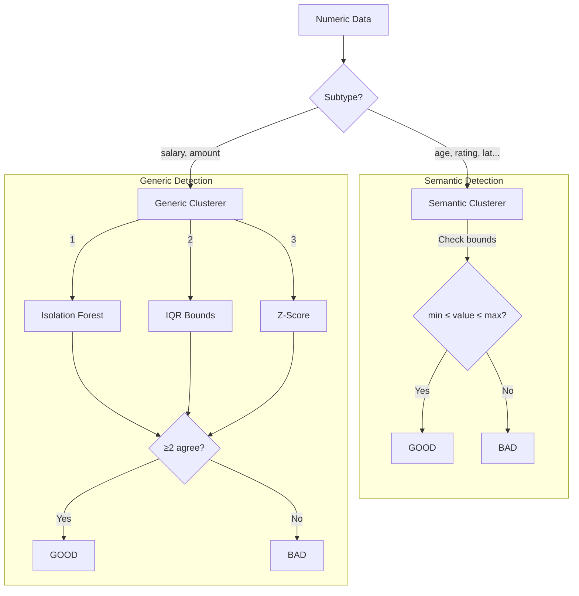
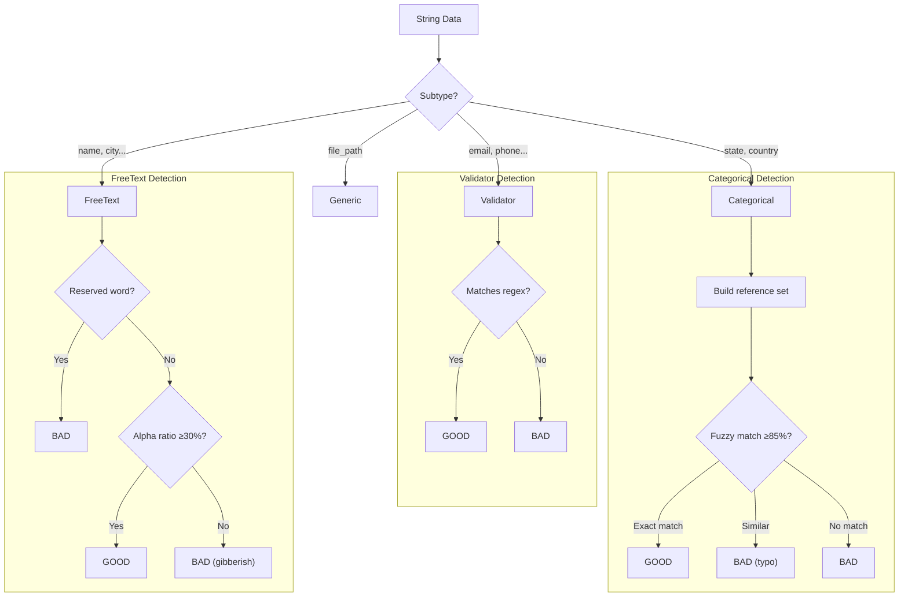
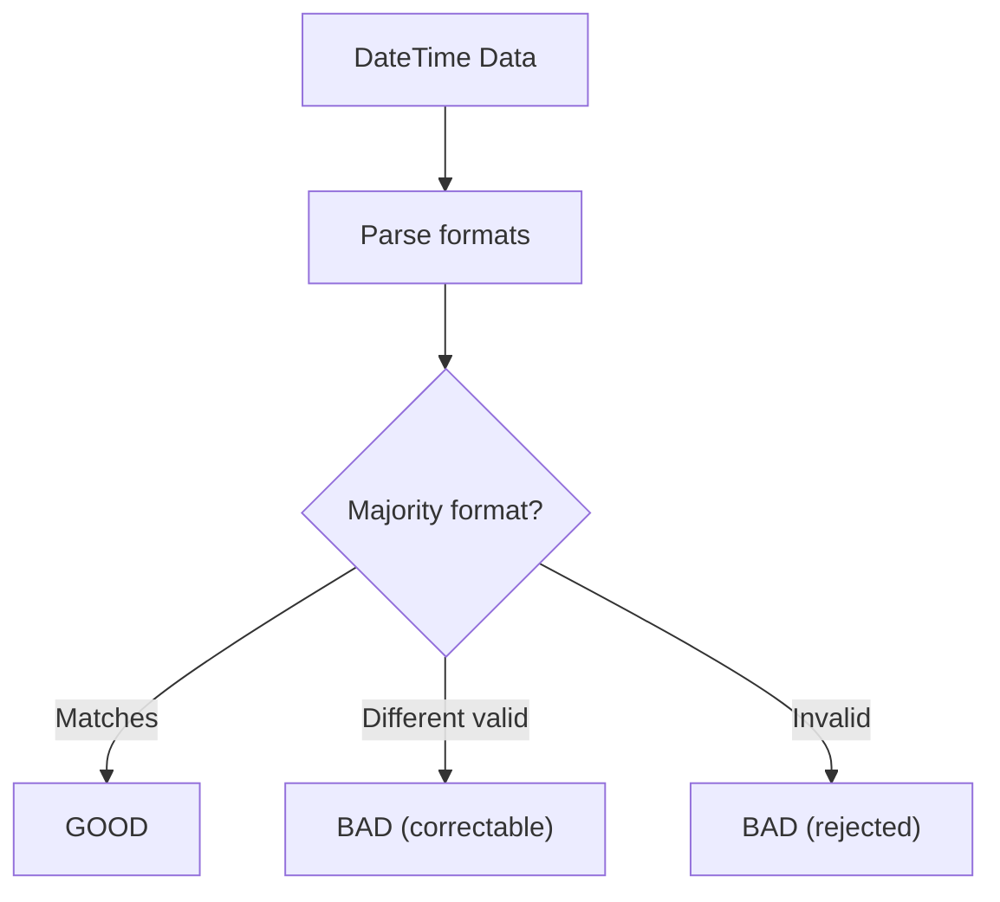
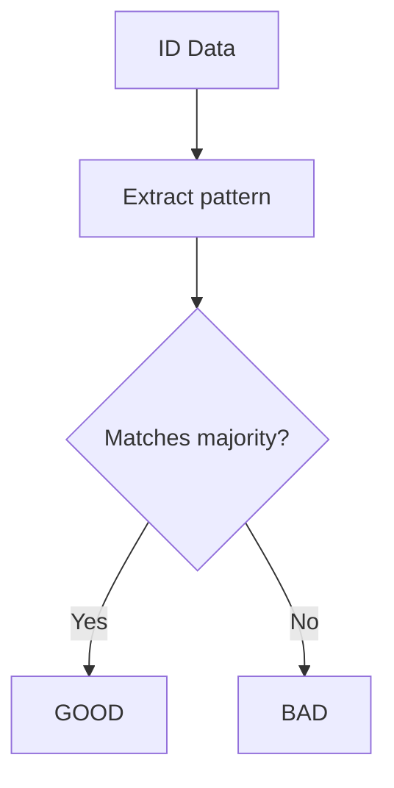

# Anomaly Detection Pipeline Architecture

## Overview



---

## Workflows & Subworkflows

| Workflow | Subworkflow | Clusterer | Subtypes |
|----------|-------------|-----------|----------|
| **numeric** | semantic | `SemanticNumericClusterer` | age, rating, year, lat, long, %, temp |
| **numeric** | generic | `GenericNumericClusterer` | salary, amount, count |
| **string** | validator | `ValidatorStringClusterer` | email, phone, url, uuid, ip, zip, ssn, boolean |
| **string** | categorical | `CategoricalStringClusterer` | state, country |
| **string** | freetext | `FreeTextStringClusterer` | name, company, address, city, username |
| **string** | generic | `GenericStringClusterer` | file_path, product_title |
| **datetime** | format | `FormatDateTimeClusterer` | date, datetime |
| **datetime** | generic | `GenericDateTimeClusterer` | unknown date formats |
| **identifier** | pattern | `PatternIdentifierClusterer` | pattern_id, numeric_id |
| **identifier** | generic | `GenericIdentifierClusterer` | unknown ID patterns |

---

## Numeric Workflow



**Semantic Bounds:**
- age: 0-120 | rating: 0-10 | year: 1900-2100
- latitude: -90 to 90 | longitude: -180 to 180

**Generic Ensemble:** IsolationForest + IQR + Z-score (2/3 voting)

---

## String Workflow



**Validators:** email, phone, url, uuid, ip_address, zipcode, ssn, boolean

**Categorical:** Frequency-based with typo filtering (80-99% similarity)

**FreeText:** Lenient - rejects only reserved words + gibberish

---

## DateTime Workflow



**Format Detection:** Identifies majority format (e.g., `%Y-%m-%d`)

---

## Identifier Workflow



**Pattern Signature:** e.g., `AN` for alphanumeric like "C001"

---

## File Structure

```
backend/core/clustering/
├── strategy_selector.py      # Routes subtype → clusterer
├── dynamic_selector.py       # Runtime is_categorical() check
├── base_clusterer.py         # Abstract base class
├── numeric/
│   ├── semantic_clusterer.py # Bounds checking
│   └── generic_clusterer.py  # ML ensemble
├── string/
│   ├── validator_clusterer.py # Regex validators
│   ├── categorical_clusterer.py # Frequency+fuzzy
│   ├── freetext_clusterer.py  # Lenient
│   └── generic_clusterer.py   # DBSCAN-based
├── datetime/
│   ├── format_clusterer.py    # Format consistency
│   └── generic_clusterer.py
└── identifier/
    ├── pattern_clusterer.py   # Pattern signature
    └── generic_clusterer.py
```

---

## Detection Logic Summary

| Clusterer | Detection Method | Threshold |
|-----------|------------------|-----------|
| SemanticNumeric | Config bounds (min/max) | Exact |
| GenericNumeric | IQR + Z-score + IsolationForest | 2/3 vote |
| Validator | Regex pattern matching | 100% match |
| Categorical | Frequency + Fuzzy matching | 85% similarity |
| FreeText | Reserved words + Alpha ratio | 30% alpha |
| DateTime | Format consistency | Majority |
| Identifier | Pattern signature | Majority |
